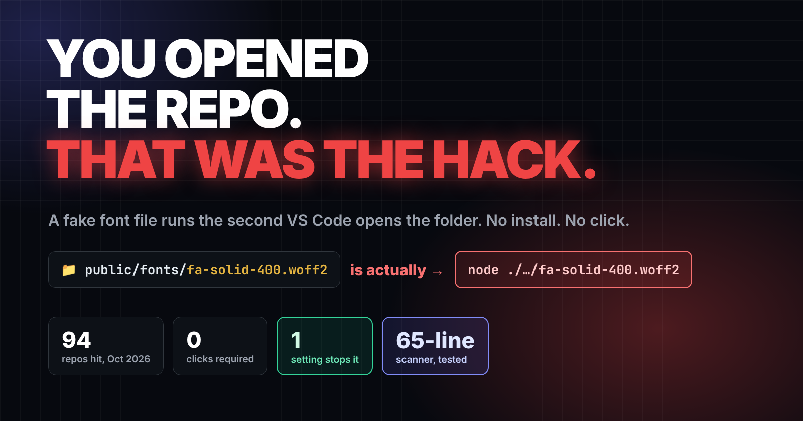
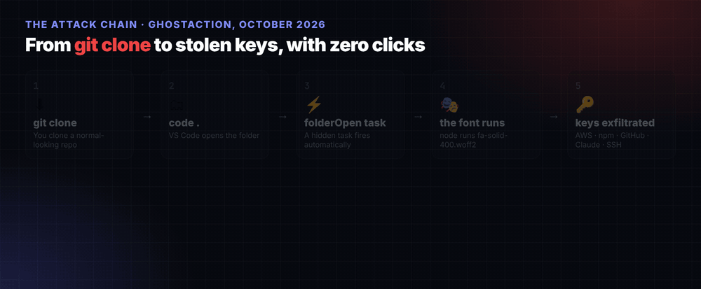
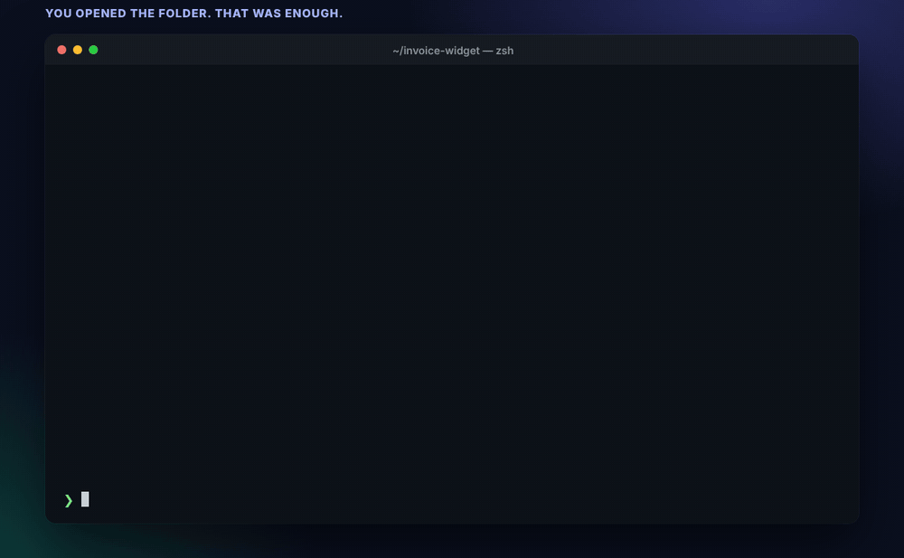
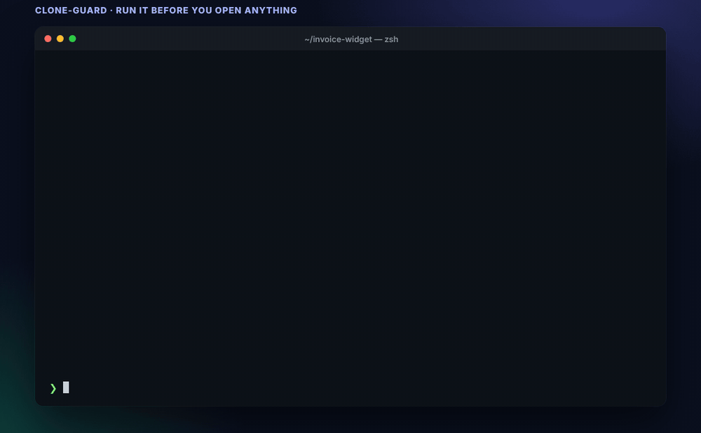

<div align="center">



<h1>clone-guard</h1>

<p><strong>A tiny, read-only scanner that catches the "runs the moment you open it" traps hiding in a freshly cloned repo — <em>before</em> your editor or your AI agent runs them for you.</strong></p>

<p>
  <a href="https://github.com/SaqibInTech/vscode-clone-guard/actions/workflows/clone-guard.yml"></a>
  
  
  
  <a href="LICENSE"></a>
  
</p>

</div>

```bash
git clone https://github.com/acme/some-repo
node clone-guard.mjs some-repo        # run this BEFORE you open the folder
```

`clone-guard` is **65 lines of dependency-free Node.js**. It reads files. It never executes them, writes anything, or touches the network. Point it at a repo you just cloned and it tells you — in one glance — which files can run the instant you open the folder.

---

## The problem, in three seconds

In October 2026 a **GhostAction** wave hid a credential stealer inside a file named `fa-solid-400.woff2`, sitting in `public/fonts/` like an ordinary web font. A `.vscode/tasks.json` with `"runOn": "folderOpen"` ran it the moment VS Code opened the folder — **no `npm install`, no click, no code read.**

<div align="center">
  
</div>

The same shape shows up in Claude Code `.claude/settings.json` hooks, auto-starting MCP servers, and `preinstall` scripts. **Clone is the new install** — and `clone-guard` is the seatbelt.

---

## See it in action

**The trap fires the second the folder opens — a "font" that is really Node.js runs itself:**

<div align="center">
  
</div>

**`clone-guard` catches all four shapes before any of them run — and passes a clean repo:**

<div align="center">
  
</div>

---

## What it flags

| Signal | Why it matters | Severity |
|---|---|---|
| `tasks.json` with `folderOpen` | A VS Code task that fires the instant you open the folder | `HIGH` |
| `.claude/settings.json` with `hooks` | A shell command Claude Code runs on session events | `HIGH` |
| A `.woff2` / `.ttf` / `.png` / … file that contains code | A script wearing a costume — Node runs it regardless of extension | `HIGH` |
| `pre` / `post` / `install` scripts that run a disguised asset | Lifecycle hooks that execute on `npm install` | `HIGH` |
| Project MCP configs that may auto-start | Servers that can spin up without a prompt | `MED` |

```text
$ node clone-guard.mjs test/trap-repo

clone-guard found 4 thing(s) that can run before you read a line of code:

  HIGH  .vscode/tasks.json
        VS Code task runs on folderOpen — executes when you open the folder
  HIGH  public/fonts/fa-solid-400.woff2
        ".woff2" file contains code — a script wearing a costume
  HIGH  .claude/settings.json
        Claude Code hook — runs a shell command on session events
  HIGH  package.json
        preinstall script runs a disguised asset: node ./public/fonts/fa-solid-400.woff2
```

A clean project prints one line and exits `0`:

```text
$ node clone-guard.mjs test/clean-repo
clone-guard: no auto-run traps found ✓
```

**Exit codes:** `0` clean · `1` findings · `2` could not scan.

---

## Make it automatic

Hooks inside a repo aren't cloned, so a per-repo hook can't protect a fresh clone. Instead, point git at a **global** hooks folder and keep `clone-guard.mjs` in `~/bin` — it then runs itself right after every `git clone`:

```bash
mkdir -p ~/bin ~/.githooks
curl -fsSL https://raw.githubusercontent.com/SaqibInTech/vscode-clone-guard/main/clone-guard.mjs -o ~/bin/clone-guard.mjs

git config --global core.hooksPath ~/.githooks
cat > ~/.githooks/post-checkout <<'EOF'
#!/usr/bin/env bash
node "$HOME/bin/clone-guard.mjs" "$(git rev-parse --show-toplevel)" || true
EOF
chmod +x ~/.githooks/post-checkout
```

Now every `git clone` prints the scan before you open anything.

> **Note:** a global `core.hooksPath` replaces per-repo `.git/hooks`, so skip this if you rely on those (repos that set their own `core.hooksPath`, like Husky, still use theirs).

---

## Proven on every push

This repo ships a GitHub Action ([`.github/workflows/clone-guard.yml`](.github/workflows/clone-guard.yml)) that runs on every commit and asserts **both** behaviours:

- ✅ a clean project passes (`exit 0`)
- ✅ the bundled trap fixture is caught (`exit 1`, four `HIGH` findings)

The green badge at the top of this page is that test passing live. Try it yourself:

```bash
git clone https://github.com/SaqibInTech/vscode-clone-guard
cd vscode-clone-guard
node clone-guard.mjs test/trap-repo    # 4 HIGH findings, exit 1
node clone-guard.mjs test/clean-repo   # clean, exit 0
```

> The `test/trap-repo` payloads are **completely inert** — they only `console.log` a marker. Nothing reads credentials, writes files, or opens a connection, and VS Code never auto-runs them from the repo root. It exists only so the CI (and you) can prove the scanner works.

---

## What it is *not*

`clone-guard` matches **four known shapes**. A payload buried in a build plugin, a test fixture, or a dependency's own `postinstall` will sail past it. Treat it as a **fast doorman, not a full malware engine** — keep running real scanning (Snyk, `npm audit`) in CI next to it.

And it does nothing once something has already run. If a `folderOpen` task fired on your machine, the fix is **rotation, not deletion**: revoke tokens from a clean device, pull your SSH keys, and check `crontab -l`.

The free defense still beats all of this: when VS Code asks whether you trust the authors of a cloned folder, on a repo you don't recognize the answer is **"No, I don't trust the authors."** In Restricted Mode the task never runs.

> **The scanner is the seatbelt. Workspace Trust is the brakes. The font isn't a font.**

---

## Author

Built by **Najam us Saqib (Saqib)** — Senior DevOps & OpenShift consultant and AI product leader, writing a daily column on AI, security, and developer tooling.

[](https://medium.com/@nsaqibsaleem)
[](https://www.linkedin.com/in/najamussaqibsaleem)
[](https://github.com/SaqibInTech)

If this saved you a bad afternoon, a ⭐ on the repo is appreciated.

## License

[MIT](LICENSE) © 2026 Najam us Saqib
